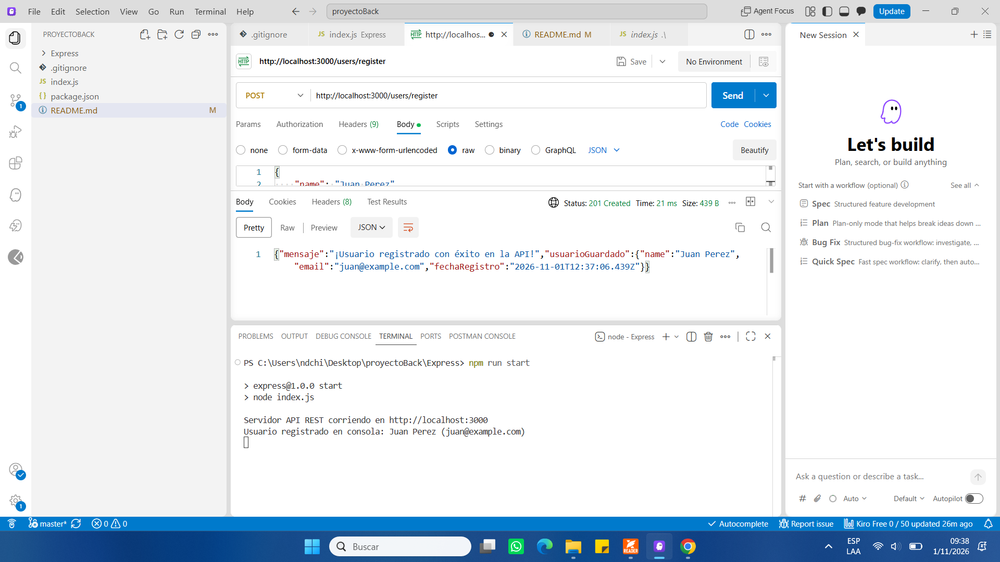

# 🚀 Repaso de Backend: Node.js Nativo vs. Express JS

Este repositorio contiene las prácticas y misiones de backend desarrolladas para el curso **Talento Tech (Buenos Aires Aprende)**. Aquí se consolidan los conceptos clave de las Clases 9, 10 y 11 sobre arquitectura de APIs REST, enrutamiento dinámico y manejo de módulos modernos.

---

## ⚙️ 1. Configuración Inicial del Entorno

Para iniciar cualquier proyecto backend desde cero utilizando el estándar moderno de JavaScript, los pasos secuenciales son:

1. **Inicializar el proyecto:**  
   `npm init -y` (Genera el archivo `package.json` base).
2. **Habilitar Módulos ES (ESM):**  
   Agregar `"type": "module"` en el `package.json` para poder usar las instrucciones `import` y `export` en lugar del antiguo `require()`.
3. **Definir el script de arranque:**  
   Configurar `"start": "node index.js"` dentro del objeto `"scripts"`.
4. **Instalar Express:**  
   `npm install express` (Descarga el framework en la carpeta local `node_modules`).
5. **Configurar Git de forma segura:**  
   Crear un archivo `.gitignore` en la raíz y agregar `node_modules/` arriba de todo para evitar rastrear archivos pesados de librerías.

---

## 🔄 2. El Flujo de una API REST: Arquitectura de Capas

A diferencia de los servidores tradicionales que sirven páginas web estáticas (HTML/CSS), una **API REST** prescinde de la capa de vistas y se comunica intercambiando datos puros en formato **JSON**. El flujo de responsabilidades se divide en:

```text
Cliente (Postman) ──> Middlewares ──> Rutas (Endpoints) ──> Controlador/Lógica ──> Datos (Array/JSON)
```
## siempre antes de las pruebas iniciar el servidor que esta en la carpeta Express
## situarse en ella y ejecutar :npm run start
### 🧠 Conceptos Clave del Servidor:
* **`app.use(cors())`**: Middleware que habilita el control de acceso de origen cruzado, permitiendo que navegadores desde otros dominios consulten la API de forma segura.
* **`app.use(express.json())`**: El "traductor". Intercepta las peticiones, procesa el texto plano en formato JSON entrante y lo transforma en un objeto JS accesible mediante `req.body`.
* **`next`**: Función que actúa como un silbato para indicarle a Express que el middleware actual terminó su lógica y la petición puede avanzar al siguiente bloque de control.

---

## 🛣️ 3. Métodos HTTP y Manejo de Parámetros

El servidor escucha una combinación de **Ruta (Path)** y **Método HTTP** para decidir qué acción ejecutar. Un mismo path (ej: `/users`) puede comportarse de maneras totalmente distintas:

### 📥 Método GET (Obtener recursos)
Se usa para pedir información al servidor. El navegador lo ejecuta por defecto al escribir una URL.
* **Path Params (`req.params`)**: Parámetros obligatorios en la URL marcados con dos puntos (ej: `/users/:id`). Sirven para identificar un recurso único (ej: `/users/542`).
* **Query Params (`req.query`)**: Parámetros opcionales que viajan al final de la URL separados por un signo de pregunta (ej: `/buscar?categoria=computacion`). Se usan para filtrar o buscar.

### 📤 Método POST (Crear recursos)
Se usa para enviar información nueva y sensible hacia el servidor. Los datos viajan ocultos dentro del cuerpo de la petición (**`req.body`**). Se prueba de forma profesional utilizando herramientas como **Postman**.
## Cambiar desplegable de Postman  POST
## ruta http://localhost:3000/users/register
## en Body seleccionar raw
## pestaña desplegable en JSON !!!!!
## En el cuerpo de la peticion copiar y pegar luego del 1 que se ve 
{
    "name": "Juan Perez",
    "email": "juan@example.com",
    "password": "secreto123"
}
## Al hacer clic en Send, servidor responderá con el código 201 Created y este JSON
##
## en consola veras Usuario registrado en consola: Juan Perez (juan@example.com)
PS C:\Users\ndchi\Desktop\proyectoBack\Express> npm run start 

> express@1.0.0 start
> node index.js

Servidor API REST corriendo en http://localhost:3000
Usuario registrado en consola: Juan Perez (juan@example.com)


## 🛡️ 4. Control de Errores Robustos (Middleware 404)

Para evitar que el servidor devuelva textos planos feos por defecto (*Cannot GET*), se posiciona un middleware global **al final de todas las rutas**:

```javascript
app.use((req, res, next) => {
    res.status(404).json({
        error: 404,
        mensaje: "Recurso no encontrado o ruta inválida."
    });
});
```
Si una petición no coincide con ninguna ruta programada, cae en este bloque, el cual frena el flujo y responde con un código de estado `404 Not Found` estructurado de manera profesional.

---

## 🧪 5. Cómo Probar la API de forma Profesional

Dado que los navegadores web tradicionales solo pueden realizar peticiones `GET` directamente desde la barra de direcciones, utilizamos herramientas de testeo para simular todo el espectro de una API REST.

### 🦊 Opción A: Usando la Aplicación Postman

Postman actúa como un espejo: recibe los paquetes de texto que fabrica tu servidor (JSON y Códigos de Estado) y los muestra de forma ordenada en pantalla.

#### 1. Probar una petición GET (Con parámetros)
1. Abrir una pestaña nueva con el botón `+`.
2. Asegurarse de que el método desplegable izquierdo diga **`GET`**.
3. Ingresar la URL dinámica en la barra, por ejemplo: `http://localhost:3000/users/542`.
4. Presionar el botón azul **`Send`**.
5. Abajo, en la pestaña **`Body -> Pretty`**, el servidor te mostrará el JSON con el ID `542` capturado de la URL.

#### 2. Probar una petición POST (Enviar datos al Body)
1. Cambiar el método desplegable de `GET` a **`POST`**.
2. Escribir la URL de registro: `http://localhost:3000/users/register`.
3. Ir a la pestaña **`Body`** (ubicada justo debajo de la barra de direcciones).
4. Seleccionar la opción **`raw`** y, en el desplegable de la derecha, cambiar `Text` por **`JSON`**.
5. Escribir el objeto con las llaves y comillas dobles estrictas:
   ```json
   {
     "name": "Tu Nombre",
     "email": "test@correo.com",
     "password": "123"
   }
   ```
6. Presionar **`Send`**. Verás el estado **`Status: 201 Created`** y la respuesta de confirmación de tu servidor.

---

### ⚡ Opción B: Usando la Extensión dentro de VS Code (Thunder Client / Postman)

Si instalaste la extensión directamente en Visual Studio Code para no abrir programas externos, el flujo es exactamente el mismo pero integrado en tu editor:

1. Hacer clic en el ícono de la extensión en la barra lateral izquierda (el rayo violeta de **Thunder Client** o el logo de **Postman**).
2. Tocar en **`New Request`** (Nueva Petición).
3. **Para GET:** Escribís la URL, elegís `GET` y le das a **Send**. El JSON aparecerá en el panel de la derecha.
4. **Para POST:** Cambiás a `POST`, vas a la pestaña **`Body`** que está abajo, elegís **`JSON`** y pegás tu objeto de pruebas antes de enviar.

*Tip:* La ventaja de la extensión es que te permite ver la terminal de Node.js abajo y los resultados del testeo al costado en una sola pantalla.



## git remote -v te muestra la url de tu protecto 
## con start https://.....  se abre 

## En el caso de Express_capas se reopartieron las responsabilidades de 
## la otra forma monolitica
## iniciar el servidor desde esta carpeta ---Desktop\proyectoBack\Express_capas> npm ## run start
## y luego probar las peticiones desde postman
Cuando un cliente (como Postman o tu frontend) haga una petición a:
GET http://localhost:3000/api/users
1. El Servidor ve que empieza con /api y se lo pasa a usuariosRouter.
2. El Enrutador ve que continúa con /users y ejecuta la función getUsers del controlador.
3. El Controlador le pide la lista a usersService.getAllUsers().
4. El Servicio retorna el array vacío [].
5. El Controlador responde al cliente con un estado 200 y el JSON []
• GET http://localhost:3000/api/users ➔ Entra por /api, pasa a usuariosRouter, y este lo lleva a /users.
• GET http://localhost:3000/api/products ➔ Entra por /api, pasa a productosRouter 
(porque el de usuarios lo ignora al no coincidir la ruta interna), y este lo lleva a /product
index.js monta cada router en su base (/api/users, /api/products) y los archivos de rutas definen solo las sub-rutas relativas (/, /register, /:id)

## Probar Postman 

. Obtener todos los usuarios

• Método: GET
• URL: http://localhost:3000/api/users
• Respuesta esperada (200 OK): [] (Un array vacío, ya que aún no hay usuarios guardados).

2. Registrar un nuevo usuario

• Método: POST
• URL: http://localhost:3000/api/users/register
• Configuración en Postman: Ve a la pestaña Body ➔ Seleccionar raw ➔ Cambia el tipo a JSON.
• Cuerpo (Ejemplo JSON a enviar):

.{
  "name": "Juan Perez",
  "email": "juan@example.com",
  "password": "mi_clave_segura_123"
}

3. Obtener un usuario por su ID

• Método: GET
• URL: http://localhost:3000/api/users/1 (Puedes cambiar el 1 por cualquier ID)

📦 Módulo de Productos


4. Obtener todos los productos

• Método: GET
• URL: http://localhost:3000/api/products

5. Crear un nuevo producto

• Método: POST
• URL: http://localhost:3000/api/products/register
• Configuración en Postman: Pestaña Body ➔ raw ➔ JSON.
• Cuerpo (Ejemplo JSON a enviar):json
{
  "name": "Teclado Mecánico",
  "price": 75.00
}

#
1. En Postman: Envíar el JSON con los tres campos:json
{
  "name": "Juan Perez",
  "email": "juan@example.com",
  "password": "mi_clave_segura_123"
}
.
2. El Controlador: Valida que estén presentes, extrae los tres valores y se los pasa ordenadamente al servicio.
3. El Servicio: Recibe los tres argumentos, genera el objeto incluyendo la contraseña y lo añade al array usuariosRegistrados.
4. La Respuesta (201 Created): Postman  devolverá un JSON confirmando el éxito de la operación junto al objeto del usuario recién creado (¡y ahora sí con su ID y fecha de registro automáticos!).


---

# ⚡ Express_async — Comunicación Asincrónica con async/await

## 🧠 Teoría: ¿Qué es la programación asincrónica?

### El problema: JavaScript es de un solo hilo

Node.js ejecuta JavaScript en un **único hilo** (un solo trabajador). Si ese trabajador se queda bloqueado esperando algo lento (leer un archivo, consultar una base de datos, llamar a una API externa), **no puede atender ninguna otra petición** mientras espera. En un servidor con muchos usuarios conectados, eso es un problema grave.

### La solución: el Event Loop + Promesas

Node.js resuelve esto con el **Event Loop**: en lugar de quedarse bloqueado esperando, delega la tarea lenta al sistema operativo y sigue atendiendo otras peticiones. Cuando la tarea lenta termina, el Event Loop avisa y se retoma desde donde se dejó.

```text
Petición A llega → Node delega la consulta a BD → sigue libre
Petición B llega → Node la atiende mientras BD procesa A
BD termina A     → Event Loop retoma A y responde
```

Esto se maneja a través de **Promesas**: objetos que representan un valor que todavía no existe pero que existirá en el futuro (o fallará).

```javascript
// Una Promesa tiene 3 estados:
// - pending  → todavía esperando
// - resolved → terminó con éxito, tiene un valor
// - rejected → terminó con error, tiene un motivo
```

### async / await: la forma moderna de escribir Promesas

`async/await` es azúcar sintáctica sobre las Promesas. Hace que el código asincrónico se lea como si fuera sincrónico, sin callbacks ni cadenas `.then()`.

```javascript
// Sin async/await (callbacks / .then):
usersService.getAllUsers()
    .then(usuarios => res.json(usuarios))
    .catch(err => next(err));

// Con async/await (la misma lógica, más legible):
const usuarios = await usersService.getAllUsers();
res.json(usuarios);
```

Reglas clave:
- **`async`** delante de una función la convierte en una función que siempre devuelve una Promesa.
- **`await`** solo se puede usar dentro de una función `async`. Pausa la ejecución de esa función hasta que la Promesa se resuelva, **sin bloquear el Event Loop** (el hilo sigue libre para otras peticiones).
- Si la Promesa se **rechaza**, el `await` lanza el error, que se puede capturar con `try/catch`.

```javascript
// Regla de oro:
// await pausa LA FUNCIÓN, no el servidor completo.
// El Event Loop sigue girando y atendiendo otras peticiones.
```

---

## 🏗️ Arquitectura de Express_async

La carpeta sigue la misma arquitectura de capas que `Express_capas`, pero **todas las comunicaciones entre capas son asincrónicas**:

```text
Cliente (Postman)
      │
      ▼
  index.js          → recibe la petición, aplica middlewares globales, deriva al router
      │
      ▼
  routes/           → decide qué controlador ejecutar según método + ruta
      │
      ▼
  controllers/      → async: valida, hace await al servicio, responde o deriva el error
      │
      ▼
  services/         → async: simula I/O lento con delay(), resuelve o rechaza la Promesa
      │
      ▼
  middlewares/      → errorHandler captura cualquier error que llegue por next(err)
```

### ¿Por qué el servicio usa `delay()`?

```javascript
const delay = (ms) => new Promise((resolve) => setTimeout(resolve, ms));
```

En producción real el servicio consultaría una base de datos (MongoDB, PostgreSQL, etc.), que tarda algunos milisegundos. El `delay(100)` simula esa latencia para que el `await` del controlador tenga sentido y se pueda observar el comportamiento asincrónico real.

---

## 🔄 Flujo completo de una petición (con errores)

### Caso exitoso: `GET /api/users/1`

```text
1. index.js
   └─ cors() y express.json() procesan la petición
   └─ app.use('/api/users', usuariosRouter) → deriva al router

2. routes/users.routes.js
   └─ router.get('/:id', getUserById) → llama al controlador

3. controllers/users.controller.js  [async]
   └─ const usuario = await usersService.getUserById('1')
      El await PAUSA el controlador. El Event Loop queda libre.

4. services/users.service.js  [async]
   └─ await delay(100)  → simula consulta a BD (100ms)
   └─ busca id=1 en el array
   └─ lo encuentra → RESUELVE la Promesa con el objeto usuario

5. Vuelve al controlador
   └─ usuario tiene el valor resuelto
   └─ res.status(200).json(usuario) → responde al cliente ✅
```

### Caso de error: `GET /api/users/999` (no existe)

```text
4. services/users.service.js
   └─ await delay(100)
   └─ busca id=999 → NO existe
   └─ const error = new Error('No existe un usuario con id 999')
      error.status = 404
      throw error  → RECHAZA la Promesa

5. Vuelve al controlador
   └─ el await relanza el error → entra al catch
   └─ catch(error) { next(error) }  → deriva al errorHandler

6. middlewares/errorHandler.js
   └─ recibe el error con err.status = 404
   └─ responde: { "error": 404, "mensaje": "No existe un usuario con id 999" }
```

---

## 🔀 Dos estrategias para manejar errores async

En `Express_async` se implementó la estrategia con `try/catch + next(err)`, pero existe una alternativa más concisa disponible en Express 5:

### Estrategia A — try/catch + next(err) ✅ (implementada)
```javascript
// Portable a Express 4 y 5. Da control para transformar el error.
export const getUsers = async (req, res, next) => {
    try {
        const usuarios = await usersService.getAllUsers();
        res.status(200).json(usuarios);
    } catch (error) {
        next(error);   // deriva al errorHandler centralizado
    }
};
```

### Estrategia B — Auto-catch de Express 5 (alternativa documentada)
```javascript
// Express 5 captura solo las Promesas rechazadas de handlers async
// y las deriva al errorHandler automáticamente. Sin try/catch.
export const getUsers = async (req, res) => {
    const usuarios = await usersService.getAllUsers();
    res.status(200).json(usuarios);
    // Si getAllUsers() rechaza → Express 5 llama al errorHandler solo
};
```

| | Estrategia A (try/catch) | Estrategia B (Express 5 auto) |
|---|---|---|
| Compatible con Express 4 | ✅ | ❌ |
| Código más corto | ❌ | ✅ |
| Control sobre el error antes de delegar | ✅ | ❌ |
| errorHandler centralizado necesario | ✅ | ✅ (no cambia) |

> El `errorHandler` es **idéntico** bajo ambas estrategias. Lo único que cambia es si el controlador llama `next(err)` manualmente o Express lo hace solo.

---

## 🚀 Cómo iniciar el servidor Express_async

```bash
# Desde la carpeta del proyecto
cd Express_async
npm install          # solo la primera vez
npm run dev          # o: node index.js
```

Servidor en: `http://localhost:3000`

> ⚠️ No tener levantado `Express_capas` al mismo tiempo: ambos usan el puerto 3000.

---

## 🧪 Probar con Postman — Express_async

### Usuarios

| Método | URL | Body JSON |
|---|---|---|
| GET | `http://localhost:3000/api/users` | — |
| POST | `http://localhost:3000/api/users/register` | `{"name":"Ana","email":"ana@mail.com","password":"1234"}` |
| GET | `http://localhost:3000/api/users/1` | — |

### Productos

| Método | URL | Body JSON |
|---|---|---|
| GET | `http://localhost:3000/api/products` | — |
| POST | `http://localhost:3000/api/products/register` | `{"name":"Teclado","price":25.5}` |

### Casos de error (para ver el errorHandler y el flujo asincrónico)

| Método | URL | Respuesta esperada | Qué demuestra |
|---|---|---|---|
| GET | `http://localhost:3000/api/users/999` | `404` — usuario no existe | Servicio rechaza Promesa → catch → next(err) → errorHandler |
| POST | `http://localhost:3000/api/users/register` | `400` — faltan campos | Validación sincrónica en el controlador (responde directo) |
| GET | `http://localhost:3000/api/ruta-rara` | `404` — recurso no encontrado | notFoundHandler (ninguna ruta coincide) |

> 💡 **Tip:** Con el `GET /api/users/999` mirá la terminal del servidor — vas a ver `"Error capturado por el errorHandler:"` seguido del stack trace. Eso confirma que el flujo asincrónico de errores está funcionando.
